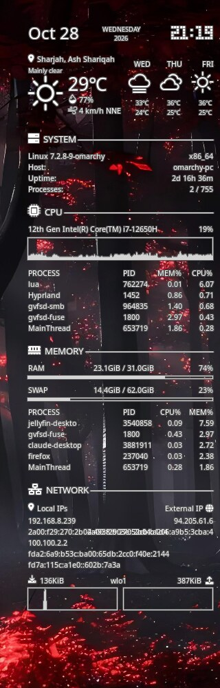

# Lean Conky Config — Wayland Edition

> A lean, elegant Conky panel that **just works** on modern Linux — including **Hyprland**, **Omarchy**, and other Wayland desktops — with **full IPv4 + IPv6** network display.

[](LICENSE)
[](https://github.com/brndnmtthws/conky)
[](#wayland--hyprland--omarchy)
[](#ipv4--ipv6-network-panel)

Based on the excellent [jxai/lean-conky-config](https://github.com/jxai/lean-conky-config), this fork ships the tweaks you actually need in 2026: a Wayland-friendly launcher, Omarchy/Hyprland-friendly defaults, and a network section that no longer pretends the internet is IPv4-only.

> **Credit:** Lean Conky Config was created and is maintained by **[Jason Xu (@jxai)](https://github.com/jxai)**.  
> Upstream project: [github.com/jxai/lean-conky-config](https://github.com/jxai/lean-conky-config)  
> This repository is a derivative fork — all credit for the original design, architecture, and LCC itself belongs to Jason.

<p align="center">
  
</p>

---

## Why this fork?

Stock Lean Conky Config is beautiful — but two things bite hard on current setups:

| Problem | What this fork does |
|--------|----------------------|
| **IPv6 invisible** | Upstream filters `inet6` and strips `:` from addresses. Fixed: local + external **IPv4 and IPv6**. |
| **Wayland / Hyprland** | Bundled `start-lcc.sh` prefers a patched Conky binary for layer-shell desktops, with a ready `local.conf` example for Omarchy. |

Everything else you love about LCC stays: auto-discovered NICs and disks, single-config scaling for any resolution, modular panel components, custom icon font.

---

## Features

- **IPv4 + IPv6** — local globals and external addresses side by side
- **Wayland-ready** — works on Hyprland / Omarchy without fighting Xwayland
- **Auto discovery** — network interfaces and mounted disks appear and disappear live
- **One scale knob** — `lcc.config.scale` fits 1080p, 1440p, 4K without rewriting offsets
- **Composable panel** — pick datetime, weather, CPU, memory, GPU, storage, network…
- **Graceful fonts** — custom `LeanConkyConfig` icons with sane fallbacks

---

## Quick start

### 1. Install Conky

```bash
# Arch / Omarchy / CachyOS / EndeavourOS
sudo pacman -S conky

# Debian / Ubuntu
sudo apt install conky-all

# Fedora
sudo dnf install conky
```

Need a newer build? Official AppImages: [Conky releases](https://github.com/brndnmtthws/conky/releases).

Forgot this step? `start-lcc.sh` stops with `ERROR: Conky is not installed.` and the install command, and leaves any running panel alone.

### 2. Install this config

```bash
git clone https://github.com/mysh264/lean-conky-config.git ~/.config/conky
cd ~/.config/conky
cp local.conf.example local.conf   # or use the Wayland preset below
./start-lcc.sh
```

Within a few seconds the panel docks to the right edge of your desktop.

> Already have files in `~/.config/conky`? Clone somewhere else and point Conky at that directory, or back up first.

### 3. Autostart (Hyprland / Omarchy)

Add to `~/.config/hypr/autostart.lua` (or your autostart file):

```lua
os.execute("~/.config/conky/start-lcc.sh &")
```

Or a desktop entry:

```bash
mkdir -p ~/.config/autostart
cat > ~/.config/autostart/lean-conky.desktop <<'EOF'
[Desktop Entry]
Type=Application
Name=Lean Conky Config
Exec=/home/$USER/.config/conky/start-lcc.sh
X-GNOME-Autostart-enabled=true
EOF
```

---

## Wayland / Hyprland / Omarchy

Conky's Wayland output has a startup bug: `set_font()` asserts that the font list is not empty, but it runs once before the fonts are loaded, so distro builds (which keep asserts on) abort. `start-lcc.sh` works around it without touching your system Conky:

1. `tools/patch-conky-wayland` copies the system `conky` to `./conky-wayland` and turns that one assert into a plain return (4 bytes change: before the fonts are loaded the call just returns; after that it works exactly as before).
2. It finds the code by its **shape**, anchored on the binary's import of `pango_layout_set_font_description`, not by fixed bytes or addresses. So it works on Arch's build, **CachyOS's x86-64-v3/v4 rebuilds**, Omarchy, and later versions with the same code. If the shape is not there it changes nothing, warns, and runs the system Conky.
3. `conky-wayland.source` records which system binary the copy was made from (path + checksum). Any Conky update re-patches on the next start.

Run the tool by hand to see what it does:

```bash
python3 tools/patch-conky-wayland /usr/bin/conky /tmp/conky-test
```

For a transparent, bottom-layer panel that sits above the wallpaper and under windows (tuned for Omarchy’s tab bar), start from the Wayland example:

```bash
cp local.conf.wayland.example local.conf
./start-lcc.sh -n    # -n = no startup pause
```

Highlight settings in that preset:

- `output_backend = "wayland"`
- transparent ARGB window, outline for readability on busy wallpapers
- `gap_y` cleared for the top bar
- fonts restated without Fontconfig `:normal:` quirks

Reload a running instance:

```bash
./start-lcc.sh -r
```

---

## IPv4 + IPv6 network panel

Keeps the classic LCC two-column layout, now dual-stack:

```
Local IPs                         External IP
192.168.x.x                       a.b.c.d
2a00:…:…                          2a00:…:…
100.x.x.x
fd12:…:…
```

How it works:

- **Local** — IPv4 + IPv6 from real NICs (same discovery as the graphs), plus Tailscale when present
- **Filtered** — skips docker/veth bridges and temporary privacy addresses so the panel stays short
- **External IPv4** — `api.ipify.org` (Amazon checkip fallback)
- **External IPv6** — `api64.ipify.org` over IPv6

No IPv6 uplink? The right-hand IPv6 field stays blank and the rest of the panel is unchanged.

---

## Customization

Never edit `conky.conf` for day-to-day tweaks. Copy and edit `local.conf`:

```bash
cp local.conf.example local.conf
$EDITOR local.conf
```

### Scale the whole panel

```lua
lcc.config = {
    scale = 1.25,  -- >1 enlarges, <1 shrinks; layout proportions stay intact
}
```

### Reorder or drop components

```lua
lcc.panel = {
    "datetime",
    "weather",
    "system",
    "cpu",
    "memory",
    -- "storage",  -- omit to hide
    "network",
    { "vspace", -13 },
}
```

### Colors & docking

```lua
conky.config = {
    alignment = "top_left",
    gap_x = 20,
    gap_y = 40,
    color0 = "turquoise",  -- clock
    color1 = "orange",     -- heading 1
    color2 = "dodgerblue", -- heading 2
    color3 = "limegreen",  -- charts
}
```

More knobs live in `local.conf.example` — storage filters, top-N process lists, NVIDIA GPU (`gpu.nvidia` + `pip install pynvml`), weather location, and fonts.

---

## Useful commands

| Command | What it does |
|---------|----------------|
| `./start-lcc.sh` | Start (kills previous LCC instance first) |
| `./start-lcc.sh -n` | Start immediately (no 3s pause) |
| `./start-lcc.sh -r` | Reload running LCC (`SIGUSR1`) |
| `./start-lcc.sh -p /path/to/conky` | Use a specific Conky binary / AppImage |

---

## Font (optional but recommended)

Icons and the LCD-style clock use the bundled `LeanConkyConfig` font. `start-lcc.sh` installs it into `~/.local/share/fonts` automatically. Manual install:

```bash
./font/install -f
```

Disable and fall back to plain fonts:

```bash
./font/install -u && touch ~/.local/share/fonts/lean-conky-config.otf
```

---

## Requirements

- Conky **≥ 1.10** (1.17+ recommended for reliable net graphs; Wayland users: recent system Conky)
- `python3` — for the Wayland font fix (without it the system Conky is used as is)
- `iproute2` (`ip` command) — for local addresses
- `curl` — for external IP lookup
- Optional: `pynvml` for NVIDIA GPU component

---

## Project layout

```
lean-conky-config/
├── conky.conf              # core config (prefer local.conf for edits)
├── local.conf.example      # starter customization
├── local.conf.wayland.example
├── main.lua
├── start-lcc.sh            # launcher (+ Wayland helper)
├── tools/patch-conky-wayland  # makes ./conky-wayland (Wayland font-bug fix)
├── lib/                    # components, utils, templates
├── font/                   # LeanConkyConfig.otf + installer
├── docs/                   # upstream docs & screenshot
└── LICENSE                 # MIT
```

---

## Credits

### Original author

**[Jason Xu (@jxai)](https://github.com/jxai)** — creator of [Lean Conky Config](https://github.com/jxai/lean-conky-config).

This project would not exist without his work. The panel layout, modular component system, scaling transforms, auto device discovery, custom icon font, and the overall LCC design are his. Please star and support the [upstream repository](https://github.com/jxai/lean-conky-config) if you find Conky configs useful.

### Also thanks to

- [Brenden Matthews](https://github.com/brndnmtthws/conky) and the Conky contributors
- Everyone who improved LCC through issues and pull requests upstream

### This fork

Wayland / Omarchy / Hyprland integration and the dual-stack IPv4 + IPv6 network panel — built on top of Jason’s LCC, not a replacement for it.

---

## License

MIT — see [LICENSE](LICENSE).

Copyright for the original Lean Conky Config belongs to **Jason Xu**. This fork retains his copyright notice and adds modifications under the same MIT terms. Keep both notices when you share or fork.
